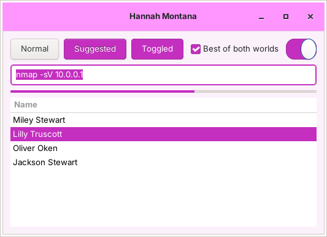
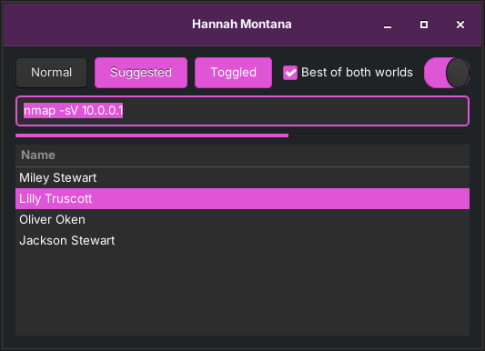

# hannah-montana-kali

Turn Kali Linux into **Hannah Montana Linux**, and back again with one key.

Press **Super+Shift+H** (the Windows key + Shift + H) and Kali switches to the Hannah Montana
wallpaper, pink theme, icons and terminal colours. Press it again and your normal Kali look comes
back exactly as it was.

| Light (pink) | Dark (purple) |
| --- | --- |
|  |  |

## Install

```bash
git clone https://github.com/ruff480/hannah-montana-kali.git
cd hannah-montana-kali
./install.sh
```

Run it as your normal user, not with `sudo`. It asks for your password when it copies the
system-wide files. By default it then:

1. installs the themes,
2. binds **Super+Shift+H** to the toggle,
3. turns the theme on.

**Works offline.** All the artwork is in this repository (`assets/hml/`, about 60 MB), so the
installer never touches the network. To install on a machine with no internet, copy the cloned
folder over (or download the repo as a ZIP from GitHub) and run `./install.sh` there.

| Option | What it does |
| --- | --- |
| `--variant dark` | Purple/dark flavour instead of pink/light |
| `--hotkey Ctrl+Alt+H` | Use a different key combination |
| `--system` | Also theme the login screen, the GRUB menu and the boot splash |
| `--no-enable` | Install and bind the key, but leave the theme off for now |
| `--no-hotkey` | Don't bind any key |

## Use

| Command | |
| --- | --- |
| **Super+Shift+H** | Toggle the theme |
| `hannah-montana-kali toggle` | Same thing, from a terminal |
| `hannah-montana-kali on` / `off` | Force it on or off |
| `hannah-montana-kali variant dark` | Switch flavour (`light` or `dark`) |
| `hannah-montana-kali hotkey on --key Super+Alt+M` | Move the hotkey |
| `hannah-montana-kali hotkey off` | Remove the hotkey |
| `hannah-montana-kali status` | Show what's on and which key is bound |
| `sudo hannah-montana-kali system on` / `off` | Login screen, GRUB menu and boot splash |

There's also a **Toggle Hannah Montana** entry in the applications menu.

## What changes

| | XFCE (Kali default) | KDE Plasma | GNOME |
| --- | --- | --- | --- |
| Wallpaper | ✓ every monitor | ✓ | ✓ |
| Lock screen background | | ✓ | ✓ |
| Colours / widget theme | Hannah Montana GTK theme | HML *PrettyPink* colours + Plasma style | Hannah Montana GTK theme, pink accent |
| Icons | Hannah Montana icons | Hannah Montana icons | Hannah Montana icons |
| Panel | pink/purple via the GTK theme | HML Plasma panel | — |
| Window borders | xfwm4 *Default* (follows GTK colours) | Breeze | — |
| Splash | | HML splash screen | |
| QTerminal colours | ✓ | ✓ | |

With `system on` (needs root, isn't part of the hotkey):

- **Login screen:** LightDM gets the Hannah Montana background and theme, or SDDM gets the HML SDDM theme on KDE.
- **GRUB menu:** the Hannah Montana background. Kali's GRUB theme is switched off while this is on.
- **Boot splash:** the HML Plymouth theme. This rebuilds the initramfs, so it takes a minute.

### How the toggle stays safe

Before the theme goes on, the script saves every setting it is about to change to
`~/.local/state/hannah-montana-kali/`. Turning it off writes those exact values back, and removes
any keys the theme created that weren't there before. So your own wallpaper, theme and icon choices
come back, not Kali's stock defaults. System changes work the same way: the original LightDM values
and Plymouth theme are saved in `/var/lib/hannah-montana-kali/`, and the GRUB/SDDM settings are
separate drop-in files that get deleted.

### Notes and limits

- **Desktops:** XFCE takes effect instantly. On **KDE**, global shortcuts are only read at login,
  so log out and back in once after installing for the hotkey to work. Running
  `hannah-montana-kali toggle` works straight away.
- **Hotkey clashes:** if the key you picked is already in use in XFCE, the installer leaves the
  existing shortcut alone and tells you. Pick another with `hotkey on --key ...`.
- **QTerminal:** the colour scheme applies to newly opened windows. QTerminal saves its settings when
  it closes, so close any open QTerminal windows before you toggle.
- **New users:** an autostart entry binds the hotkey for every user at their first login. Running
  `hotkey off` opts that user out.
- **GTK4/libadwaita apps** ignore GTK themes, so they keep their usual look. Nothing breaks.

## Uninstall

```bash
./uninstall.sh        # or /usr/share/hannah-montana-kali/uninstall.sh
```

This turns the theme off and removes the hotkey. It also undoes the login screen, GRUB and boot
splash changes, then deletes everything that was installed.

## Credits and licence

All the artwork comes from
[Hannah Montana Linux v26](https://gitlab.com/DecaCagle/hannahmontanalinux26) by Noah Cagle (GPLv3+):
wallpaper, lock screen, login and GRUB backgrounds, icon themes, *PrettyPink* colour schemes, Plasma
style, global theme, SDDM theme and Plymouth theme. That project is a modern remaster of the
[original 2009 Hannah Montana Linux](https://hannahmontana.sourceforge.net/), and its wallpaper is
rebuilt from the original. The files are bundled unmodified in [`assets/hml/`](assets/hml/SOURCE.md),
with the upstream commit they came from and their licence.

Much of the HML Plasma work is in turn based on KDE's Breeze. This repository adds the toggle
script, the GTK theme and the QTerminal colour scheme, and is licensed under the
[GNU GPL v3 or later](LICENSE), the same as the assets it uses.

Hannah Montana is a trademark of Disney. This is an unofficial fan project and isn't affiliated
with Disney, Kali Linux or Offensive Security.
